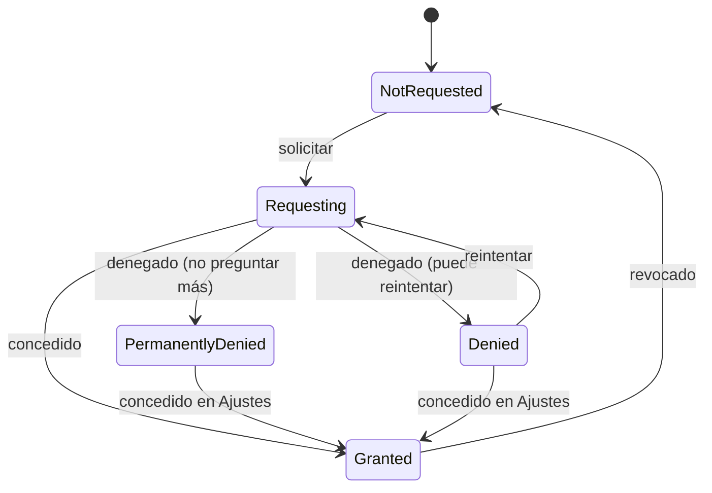

# Máquina de Estados de Permisos de Hardware

Sprint 3 · LifeSync Mobile

## 1. Objetivo

Modelar de forma explícita la **solicitud asíncrona de permisos de hardware**
(Cámara para escanear recetas y Ubicación GPS para el incidente) y garantizar
**degradación gradual**: si el usuario niega un permiso, la app no debe fallar;
solo deshabilita la función afectada y mantiene el resto operativo (incluido el
historial clínico offline).

## 2. Estados

Estados posibles de **cada** permiso (son independientes entre sí):

| Estado | Significado | ¿Función disponible? |
|---|---|---|
| `NotRequested` | Nunca se pidió o el sistema aún no respondió. | No |
| `Requesting` | El diálogo del sistema está en curso (asíncrono). | No |
| `Granted` | El usuario concedió el permiso. | Sí |
| `Denied` | Negó una vez, pero puede volver a pedirse. | No (degradado) |
| `PermanentlyDenied` | Negó y el sistema ya no muestra el diálogo (`shouldShowRequestPermissionRationale == false`). Solo se resuelve en Ajustes. | No (degradado) |

## 3. Transiciones

| Desde | Evento | Hacia | Acción asociada |
|---|---|---|---|
| `NotRequested` | `onRequestStarted()` | `Requesting` | Lanzar `RequestPermission` |
| `Requesting` | `onResult(granted=true, _)` | `Granted` | Habilitar función |
| `Requesting` | `onResult(false, canAskAgain=true)` | `Denied` | Mostrar uso degradado + reintentar |
| `Requesting` | `onResult(false, canAskAgain=false)` | `PermanentlyDenied` | Ofrecer "Abrir ajustes" |
| `Denied` | `onRequestStarted()` | `Requesting` | Reintentar |
| `Denied` / `PermanentlyDenied` | `onChecked(granted=true)` | `Granted` | Regreso desde Ajustes |
| `Granted` | `onChecked(granted=false)` | `NotRequested` | Permiso revocado en el sistema |
| `PermanentlyDenied` | `onChecked(granted=false)` | `PermanentlyDenied` | Mantener bloqueo |

`onChecked(...)` se llama en `ON_RESUME` / inicio para reconciliar el estado de
la máquina con la fuente de verdad del sistema (`checkSelfPermission`).

## 4. Mapeo práctico al código

| Concepto | Archivo |
|---|---|
| Estados | `core/permission/PermissionState.kt` |
| Permisos modelados | `core/permission/HardwarePermission.kt` |
| Máquina de estados (transiciones) | `core/permission/HardwarePermissionStateMachine.kt` |
| Orquestación / reconciliación | `presentation/permissions/PermissionsViewModel.kt` |
| UI + solicitud asíncrona | `presentation/permissions/PermissionsScreen.kt` |
| Estado de pantalla y degradación | `presentation/permissions/PermissionsUiState.kt` |

La máquina es **pura** (solo `StateFlow` de estados y transiciones) y no conoce
Android; el ViewModel la alimenta con `checkSelfPermission` y con el resultado de
`ActivityResultContracts.RequestPermission`.

## 5. Degradación gradual

| Permiso | Si se niega / bloquea | Comportamiento |
|---|---|---|
| Ubicación GPS | `Denied` / `PermanentlyDenied` | Se deshabilita **solo** el rastreo en la nube; el historial clínico sigue disponible **offline**. No hay crash. |
| Cámara | `Denied` / `PermanentlyDenied` | Se deshabilita solo el escaneo de recetas; el resto de la app sigue normal. No hay crash. |

## 6. Verificación

- Prueba unitaria de transiciones: `HardwarePermissionStateMachineTest`.
- Prueba manual: negar GPS → la sección muestra el aviso offline; entrar a
  Ajustes y conceder → al volver (`ON_RESUME`) el estado pasa a `Granted`.
